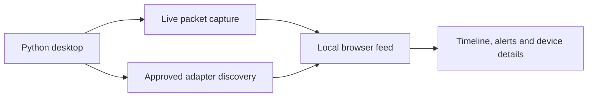

# NetGuardian

NetGuardian is a Python-based network monitoring dashboard designed for local traffic visibility, packet analysis, port activity monitoring, and alert generation. It provides a desktop interface for observing network behavior in real time and reviewing captured packet data from the local machine.

This project is intended for authorized, defensive network monitoring use on networks where you have explicit permission to inspect traffic.

## Features

- Real-time packet capture using Scapy
- Traffic monitoring for TCP, UDP, ICMP, DNS, and ARP
- Protocol distribution analysis
- Top IP and traffic usage insights
- Connected device visibility
- Port-based threshold alerting
- Live usage charts and dashboard panels
- CSV log generation and report export
- Desktop UI built with Tkinter

## Project structure

- `app.py` – main app entry point
- `gui_dashboard.py` – Tkinter dashboard and monitoring interface
- `traffic_logger.py` – packet logging utilities
- `traffic_analyzer.py` – traffic analysis and summaries
- `alert_system.py` – alert handling logic
- `report_generator.py` – report generation
- `core/` – packet capture and analysis modules
- `tests/` – automated validation tests
- `requirements.txt` – Python dependencies
- `LICENSE` – project license

## Requirements

- Python 3.10+
- Windows: run with Administrator privileges if packet capture is required
- Windows: Npcap installation recommended
- Scapy

## Installation

1. Clone the repository

   ```bash
   git clone https://github.com/karan-x23/NetGuardian-.git
   cd NetGuardian-
   ```

2. Create a virtual environment

   ```bash
   python -m venv .venv
   .venv\Scripts\activate
   ```

3. Install dependencies

   ```bash
   pip install -r requirements.txt
   ```

## Running the project

Start the dashboard:

```bash
python gui_dashboard.py
```

If packet capture does not work, check the following:

- you are running the app with administrator privileges
- Npcap is installed on Windows
- your network adapter supports traffic capture in your environment

## Usage notes

- Use only on trusted or authorized local networks
- Do not deploy in environments where monitoring permission is not explicit
- Threshold values and monitoring settings can be adjusted from the dashboard

## Testing

Run the project tests:

```bash
python -m pytest -q
```

The repository also includes a focused unittest suite for threshold behavior and dashboard logic.

## Security and legal notice

NetGuardian is intended for defensive, authorized traffic monitoring. It should not be used for unauthorized surveillance, privacy invasion, or any activity that violates laws or network policies.

## License

This project is licensed under the MIT License. See [LICENSE](LICENSE).

## Contributing

See [CONTRIBUTING.md](CONTRIBUTING.md).

## Status

NetGuardian is currently a working prototype focused on live monitoring, packet inspection, port alerting, and local network visibility. It is suitable for learning, experimentation, and defensive monitoring in approved environments.

## Limitations

- Packet capture depends on OS permissions and adapter support
- Behavior can vary by system, OS, and network conditions
- This is not a full enterprise-grade IDS/IPS platform

## Packet inspector

Open **Packet Capture** and select a row to view its frame summary and expandable Ethernet, ARP, IPv4, TCP, UDP, ICMP, or DNS fields when available. The inspector keeps headers for the latest 5,000 captured packets in memory. Use the filter to match a protocol, an IP address, or a source or destination port, for example `tcp port:443` or `192.168.1.4 udp port:53`. Press Enter to apply it to displayed rows.

### Capture analysis

Use **Open PCAP** on the Packet Capture page to inspect a PCAP or PCAPNG file in a separate window. It reads up to the first 5,000 frames and analyzes supported Ethernet/IP and ARP traffic, including IPv6 from saved captures. **Capture statistics** opens the same analysis for the latest retained live packets. The Protocols, Endpoints, and Conversations tabs show packet and byte totals. Select a conversation and choose **Show selected packets** to inspect both directions of that exchange.

## End-to-end workflow

### Live network session

1. Run `python gui_dashboard.py`.
2. In **Devices**, select the adapter and subnet and approve **Scan subnet** to populate the live device inventory.
3. Press **Start** in the desktop app and open **Live web dashboard** from the header. The browser follows the capture about once per second and displays the latest 5,000 packet rows, protocol and traffic charts, destination volume alerts, and discovered devices.
4. **Device Radar** appears on the desktop Dashboard. Its outer ring shows scan progress, and selecting a dot shows the IP, MAC, and last observed time. Dot placement is schematic. In the browser, click a radar dot or select a device to view its IP, MAC, last seen, traffic in the live window, and DNS requests visible to the capture. Encrypted DNS and traffic the adapter cannot see are unavailable. Radar dots show observed devices in a schematic layout. The Wi-Fi meter shows the selected adapter’s link quality when Windows reports it.
5. Use **Stop** in the desktop app to pause capture. The browser keeps the latest captured data visible. Closing the desktop app shuts down the local dashboard feed.



### Live investigation walkthrough

On Windows, connect to a network you can monitor and verify that Npcap is available. In **Settings**, set a temporary alert threshold suitable for your own traffic. Start capture from **Capture Overview** and generate normal traffic on your computer by opening an HTTPS page. When a destination port crosses the threshold, select that alert and click **Inspect packets**. The inspector opens the latest retained packet matching the alert's destination port. Expand its TCP or UDP and IP layers to see the fields behind that match. Use **Reports** to save the session summary.

The alert shortcut applies a `dst.port:<number>` filter to retained packets. It shows all retained matches for that destination port, including packets observed outside the alert window.

### Saved sessions

Use **Export** and **Export inventory** in the desktop app to save your session. In Traffic Explorer, import the packet CSV first, then the inventory CSV. Replay and speed controls are available for imported recordings. Select **Return to live** to resume the live feed when the browser was opened from the desktop app. The filtered traffic summary can be downloaded as JSON or saved as a PDF via **Print report**.

## Local device discovery

In the Python desktop app, open **Devices**, select an adapter and its IPv4 subnet, and click **Scan subnet**. The app displays the exact range and asks for approval before sending ARP requests. A newly detected adapter with one eligible subnet triggers the same prompt.

Discovery checks usable host addresses in directly connected private IPv4 or link-local subnets and lists devices that answer ARP. It runs in the background and can be cancelled. Devices that are asleep, isolated by Wi-Fi, or outside the selected subnet may be absent. Raw packet access requires the operating system's packet-capture permissions. On Windows, install Npcap and run with Administrator privileges if needed.

### Wi-Fi coverage on Windows

On **Devices**, select a connected Wi-Fi adapter. The signal percentage refreshes every few seconds while the page is open. Windows may require location access to report Wi-Fi link information. To measure usable range, compare the readings at known distances and note the farthest point where your connection still works reliably. The percentage measures link quality and does not encode distance.

## Device activity in Traffic Explorer

For additional device labels or authorized DNS activity in a saved session, open the matching packet export and import an inventory and activity CSV from the same network and time range. The browser associates packet bytes with inventory records by IPv4 address.

Prepare a UTF-8 CSV with the following columns in order. Use sortable timestamps in a consistent format and timezone, such as UTC ISO 8601. The device name, MAC address, type and service are optional. Inventory-only rows may leave the domain blank. DHCP lease changes can reassign an IP, so import a single inventory snapshot per session.

```csv
Timestamp,IP,Name,MAC,Type,Domain,Service
2026-11-25T09:30:00Z,192.0.2.10,Office Laptop,02:00:00:00:00:10,Laptop,,
2026-11-25T09:31:00Z,192.0.2.10,,,,docs.example,Document editor
```

Each domain row represents one observed request. Domain records may include background traffic. Service and device-type labels come from the imported CSV. Traffic Explorer processes the data locally.

## HTTP History

In your browser’s DevTools, open **Network** and export a HAR from your own browser session or test app. Open **HTTP History** in Traffic Explorer or open `web/http-history.html` directly. Import the HAR, filter by URL, method or status, and select a request to inspect its recorded headers, bodies and timing. Body previews depend on what the browser saved. The viewer reads the file locally and makes no requests to recorded URLs. HAR files can include sensitive headers or body content, so keep them private.
